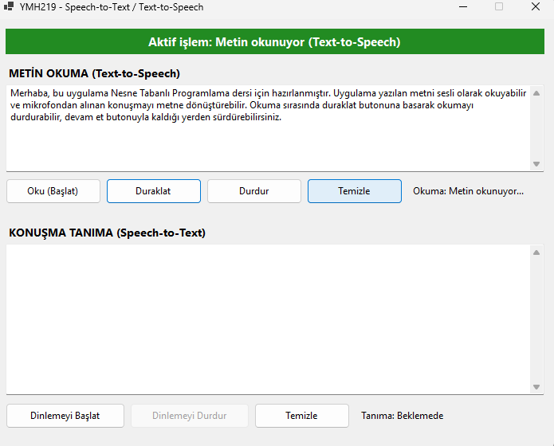
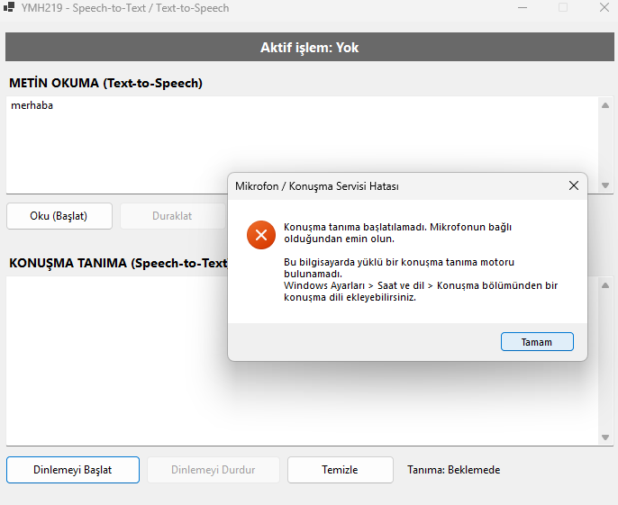

# YMH219 - Speech-to-Text ve Text-to-Speech Uygulaması

Nesne Tabanlı Programlama (YMH 219) dersi için geliştirilen, ses ve metin arasında çift yönlü dönüşüm yapan Windows Forms uygulaması. Kullanıcı yazdığı metni sesli okutabilir ve mikrofondan alınan konuşmayı metne dönüştürebilir.

## Kullanılan Teknolojiler / NuGet Paketleri
- C# / .NET 10.0
- Windows Forms (TextBox, Button, Label, Timer, MessageBox)
- **System.Speech** (NuGet paketi): `SpeechSynthesizer` (metin okuma), `SpeechRecognitionEngine` (konuşma tanıma)
- Visual Studio 2022

## Kurulum ve Çalıştırma
1. Depoyu indirin: `git clone https://github.com/elifikrac/YMH219-SpeechApp.git`
2. `SpeechApp.slnx` dosyasını Visual Studio ile açın (System.Speech paketi otomatik geri yüklenir).
3. **F5** ile çalıştırın.
4. Konuşma tanıma için bilgisayarda mikrofon ve Windows'ta yüklü bir konuşma tanıma dili gereklidir
   (Ayarlar → Saat ve dil → Dil ve bölge → English (United States) → Konuşma tanıma).

## Temel Özellikler
- **Text-to-Speech:** TextBox'taki metin **Oku (Başlat)** ile sesli okunur; **Duraklat / Devam Et**, **Durdur** ve **Temizle** işlevleri vardır.
- **Speech-to-Text:** **Dinlemeyi Başlat** ile mikrofondan alınan konuşma metin alanına yazılır; **Dinlemeyi Durdur** ve **Temizle** işlevleri vardır.
- Mikrofon veya konuşma tanıma motoru bulunamazsa anlaşılır bir hata mesajı gösterilir.
- Üstteki gösterge hangi işlemin aktif olduğunu gösterir (okuma / dinleme / yok).

## Sınıf Yapısı
| Sınıf | Görevi |
|---|---|
| `SpeechService` | Okuma ve tanıma servislerinin ortak özelliklerini tutan soyut (abstract) sınıf |
| `TextToSpeechService` | `SpeechService`'ten türetilir; SpeechSynthesizer ile metin okuma, duraklatma, durdurma |
| `SpeechToTextService` | `SpeechService`'ten türetilir; SpeechRecognitionEngine ile mikrofondan konuşma tanıma |
| `Form1` | Arayüz, buton işlemleri ve Timer ile durum güncelleme |

## Ekran Görüntüleri
**Metin okuma (Text-to-Speech)**

**Konuşma tanıma (Speech-to-Text)**

## Bilinen Sınırlamalar / Geliştirme Notları
- System.Speech, Windows'un masaüstü konuşma motorunu kullanır ve yalnızca Windows'ta çalışır.
- Bu motorda Türkçe konuşma tanıma bulunmadığından tanıma için İngilizce gibi desteklenen bir dil yüklü olmalıdır.
- Metin okuma, bilgisayarda yüklü varsayılan ses ile yapılır; Türkçe ses yüklü değilse telaffuz farklı olabilir.
- Ses hızı / ses seçimi ve metni dosyaya kaydetme eklenmemiştir.

## Öğrenci Bilgileri
- **Ad Soyad:** Elif İkra Çakmak
- **Öğrenci No:** 250541010